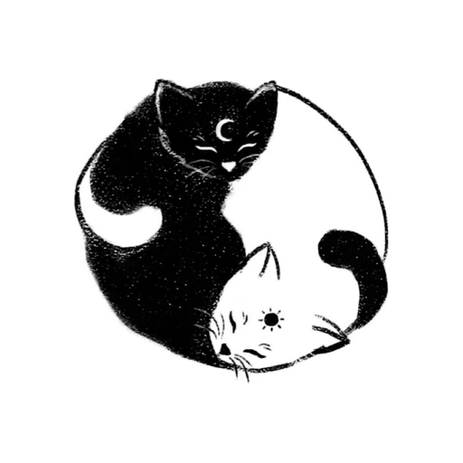

# Be Here Now

<p align="center"></p>

A SwiftUI macOS menu bar app that hides applications after they lose focus.
Requires macOS 14 or later. No third-party dependencies.

The default delay is 60 seconds. Open **Settings…** from the yin-yang icon
to change it. Each running application can use the default, a custom delay, or
**Never hide**. Delays accept seconds or minutes, from one second to 24 hours.
Settings survive restarts and application relaunches.
Turn on **Zazen mode** from the menu or settings to hide applications the moment
they lose focus, ignoring all delays. **Never hide** applications still stay visible.
Opening **Settings…** brings the settings window in front of other windows.
Turn on **Start at login** in settings to launch Be Here Now when you log in.
Be Here Now excludes itself from automatic hiding.

Hiding affects all windows of an application, like Command-H. It does not close
windows or quit applications. The menu bar yin-yang turns 180° each time an
application hides. Returning to an application resets its timer.
Existing inactive applications start their timers when Be Here Now launches.
Timers restart after wake or returning to the user session.

<p align="center"></p>

## Install

Download `BeHereNow.zip` from the
[latest release](https://github.com/aglowinthefield/beherenow/releases/latest),
unzip it, and drag **Be Here Now** to your Applications folder. Open it and the
yin-yang appears in the menu bar. Releases are signed and notarized by Apple and
run on Apple silicon and Intel Macs.

To quit, choose **Quit Be Here Now** from the yin-yang menu.

## Development

With Xcode installed, run these commands from the project directory (fish compatible).

```fish
sh scripts/install
```

This builds the app, quits any running copy, replaces `/Applications/Be Here Now.app`,
and launches it. To build without installing, run `sh scripts/build-app`, which writes
`build/Be Here Now.app`.

The script builds a universal binary for Apple silicon and Intel. The version comes
from `VERSION` and the build number from the commit count. It reuses Mu's signing
configuration: `MU_SIGN_IDENTITY`, then `~/.config/mu/signing-identity`, then
ad-hoc signing if neither is configured. An empty or invalid configured identity
fails the build rather than falling back. Developer ID signing enables hardened
runtime and includes Apple's secure timestamp. No additional entitlements are needed.

To explicitly request an ad-hoc development build (fish compatible):

```fish
env MU_SIGN_IDENTITY=- sh scripts/build-app
```

The app icon is `Resources/AppIcon.jpg` on the white tile in `Resources/AppIcon.svg`.
After changing either, run `sh scripts/icon`
to regenerate the committed `Resources/AppIcon.icns`. This needs `rsvg-convert`
(`brew install librsvg`); building the app does not.

For development, open `Package.swift` in Xcode. Run tests with `swift test`.

`sh scripts/release` creates a signed, notarized release with a stapled ticket.
It reuses `MU_NOTARY_PROFILE` or `~/.config/mu/notary-profile` and its existing
Keychain credentials. It requires Developer ID signing, checks Apple's submission
status is `Accepted`, validates the stapled ticket, and checks Gatekeeper before
creating `build/BeHereNow.zip`. Rebuilding the app requires notarizing it again.

To publish a release, bump `VERSION`, commit, then (fish compatible):

```fish
sh scripts/release
set version (cat VERSION)
git tag v$version; and git push origin v$version
gh release create v$version build/BeHereNow.zip --title "Be Here Now $version"
```

### Manual verification

Set a custom delay of five seconds for a disposable application such as TextEdit.
Switch to another application and confirm TextEdit hides after five seconds.
Return before five seconds and confirm it stays visible and gets a fresh delay
on the next switch. Check that the focused application never hides. Quit and
reopen Be Here Now to check persistence. Sleep and wake the Mac to check that
inactive applications get their full delay again.

## License

MIT. See [LICENSE](LICENSE).
